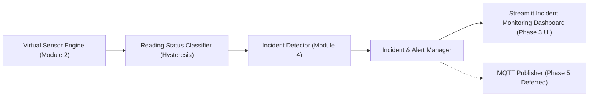
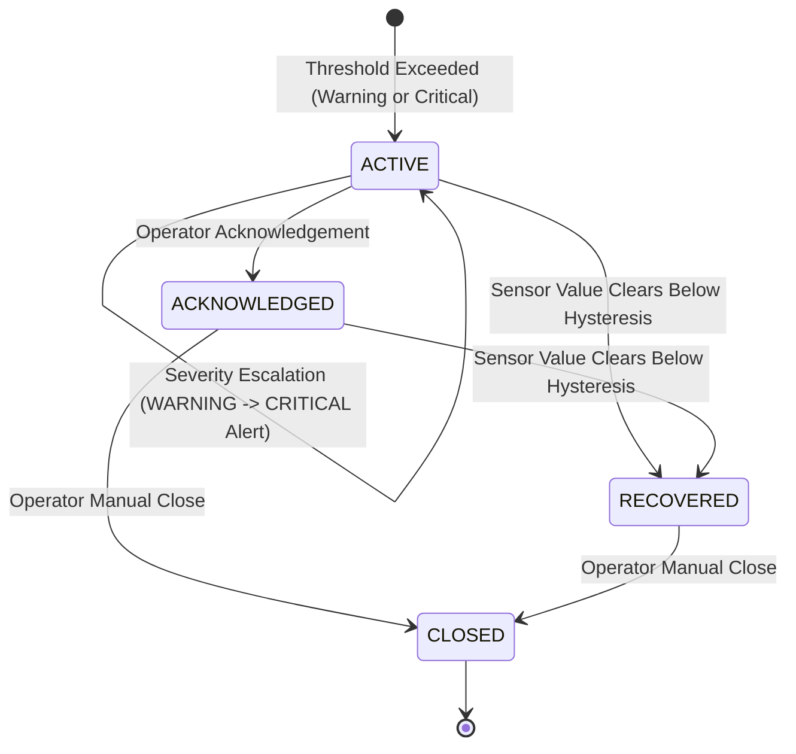
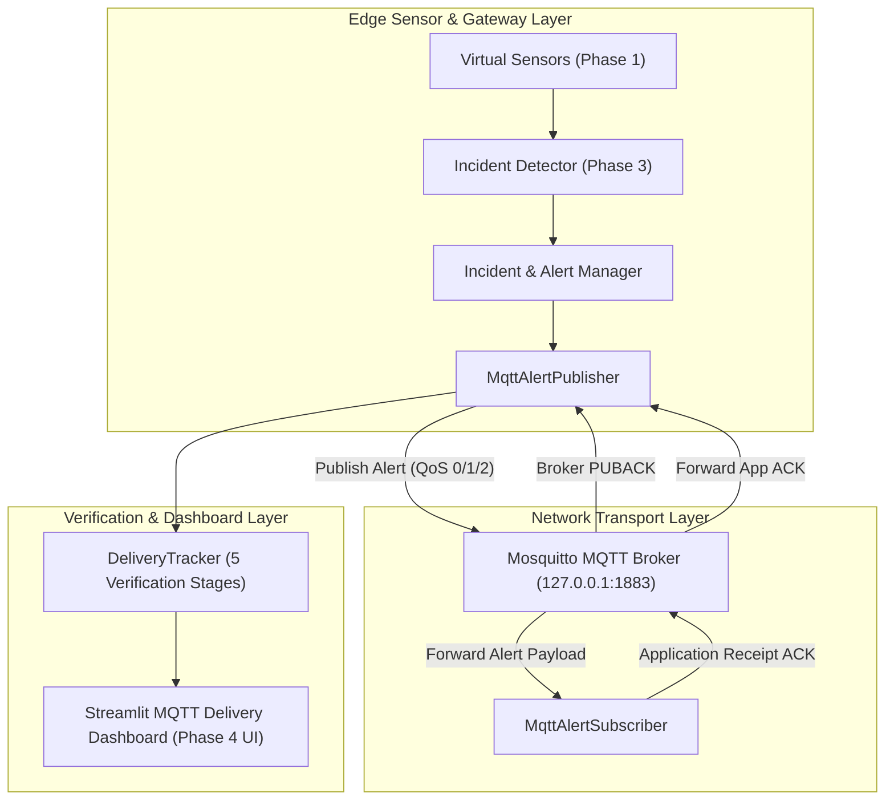

# RL-ACK: Adaptive Acknowledgment Mechanism for MQTT-based IoT Sensor Networks

## Overview

RL-ACK is a modular, interactive research and simulation platform evaluating acknowledgment (ACK) mechanisms over MQTT-enabled IoT sensor networks. The system features:
- **Virtual Sensors**: Gas, Temperature, Relative Humidity, and Smoke sensors producing realistic dynamic telemetry.
- **Incident Monitoring**: Threshold-based incident detection with independent alert generation.
- **MQTT Transport**: Real Eclipse Mosquitto broker integration with multi-stage delivery verification.
- **Policy Comparison**: Six comparative evaluation policies.
- **Adaptive Control**: Deep Q-Network (DQN) controller selecting between five underlying ACK strategies based on an 8-feature network state.
- **Storage & Analytics**: SQLite persistence and CSV export for experimental verification.

> [!IMPORTANT]
> **Safety Notice**: All virtual sensor readings, operating ranges, and incident thresholds in this framework are computer-simulated modeling parameters. They are not certified life-safety limits and must never be used as a substitute for calibrated physical safety sensors.

---

## Technology Stack

| Component | Library / System | Version / Role |
| :--- | :--- | :--- |
| Programming Language | Python | 3.13.2 |
| Interactive Dashboard | Streamlit | 1.64.0 |
| Deep Reinforcement Learning | PyTorch | 2.14.0 |
| MQTT Client Library | Paho MQTT | 2.1.0 |
| MQTT Message Broker | Eclipse Mosquitto | 2.0+ (Local broker binary) |
| Data Processing | Pandas & NumPy | 3.0.5 & 2.5.3 |
| Visualization | Plotly | 7.1.0 |
| Relational Storage | SQLite3 | Python standard library |
| Automated Testing | Pytest | 9.1.1 |

---

## Architectural Modules

The system is partitioned into twelve distinct modules:

1. **Module 1: Project Setup & Architecture** (`rl_ack/config.py`, `rl_ack/common/`, `pyproject.toml`) — *Verified*
2. **Module 2: Virtual Sensor Engine** (`rl_ack/sensors/`) — *Implemented (Phase 1)*
3. **Module 3: System Overview and IoT Topology** (`rl_ack/topology/`, `rl_ack/dashboard/`, `app.py`) — *Implemented (Phase 2)*
4. **Module 4: Sensor Monitoring and Incident Detection** (`rl_ack/monitoring/`) — *Implemented (Phase 3)*
5. **Module 5: MQTT Alert Transmission and Delivery Verification** (`rl_ack/mqtt/`) — *Implemented (Phase 4)*
6. **Module 6: Fixed ACK Policy Engine & Comparative Evaluation** (`rl_ack/policies/`) — *Implemented (Phase 5)*
7. **Module 7: DQN Architecture and Training** (`rl_ack/dqn/`) — *Implemented (Phase 6)*
8. **Module 8: DQN Controller Integration** (`rl_ack/controller/`) — *Subsequent Phase (Phase 7)*
9. **Module 9: Interactive Simulation Runner** (`rl_ack/simulation/`) — *Subsequent Phase*
10. **Module 10: Experiment Data Storage** (`rl_ack/storage/`) — *Subsequent Phase*
11. **Module 11: Performance Analysis and Export** (`rl_ack/analysis/`) — *Subsequent Phase*
12. **Module 12: End-to-End Testing Suite** (`tests/`) — *Continuous Verification*

---

## Phase 1: Virtual Sensor Engine Architecture

The Virtual Sensor Engine acts as the single source of truth for all telemetry data across the platform.

### Mathematical Dynamics
Each sensor model is governed by a discrete-time mean-reverting bounded Ornstein-Uhlenbeck stochastic process:

$$x_t = \text{clamp}\Big(x_{t-1} + k \cdot (\mu_t - x_{t-1}) + \sigma \cdot \epsilon_t, \; [\text{min\_value}, \text{max\_value}]\Big)$$

- $\mu_t$: Target baseline under normal conditions, or dynamic target under active environmental incidents.
- $k \in [0.0, 1.0]$: Mean-reversion pull rate.
- $\sigma \ge 0.0$: Gaussian noise standard deviation.
- $\epsilon_t \sim \mathcal{N}(0, 1)$: Pseudorandom variate from a dedicated per-sensor RNG.

### The Four Required Virtual Sensors

| Sensor ID | Type | Measurement | Unit | Interval | Range | Baseline | Threshold | Host Node |
| :--- | :--- | :--- | :--- | :--- | :--- | :--- | :--- | :--- |
| `GAS-001` | `gas` | Gas concentration | `ppm` | 1.0 s | $[0.0, 1000.0]$ | 50.0 ppm | 400.0 ppm | `NODE-001` |
| `TEMP-001` | `temperature` | Ambient temperature | `°C` | 1.0 s | $[-20.0, 100.0]$ | 24.0 °C | 55.0 °C | `NODE-002` |
| `HUM-001` | `humidity` | Relative humidity | `% RH` | 2.0 s | $[0.0, 100.0]$ | 45.0 % RH | 85.0 % RH | `NODE-003` |
| `SMOKE-001` | `smoke` | Optical obscuration | `% obs/m` | 1.0 s | $[0.0, 20.0]$ | 0.2 % obs/m | 3.5 % obs/m | `NODE-004` |

### Sensor Reading Data Contract (`SensorReading`)
Each generated reading is an immutable-style typed dataclass containing all 10 required fields:
1. `sensor_id`: Stable instance identifier (e.g. `GAS-001`).
2. `sensor_type`: Categorical type (`SensorType.GAS`, etc.).
3. `value`: Finite numeric float clamped to the sensor's physical range.
4. `unit`: Physical measurement unit string (e.g. `ppm`, `°C`, `% RH`, `% obs/m`).
5. `simulation_time_s`: Elapsed monotonic simulation clock in seconds.
6. `timestamp_utc`: ISO 8601 UTC timestamp string (`YYYY-MM-DDTHH:MM:SS.mmmmmm+00:00`).
7. `sampling_interval_s`: Configured sampling period in seconds.
8. `host_node_id`: Configured host node identifier.
9. `status`: Operational status (`NodeOperationalStatus.NORMAL` or `OFFLINE`).
10. `sequence_number`: Strictly monotonic integer starting at 1 per sensor.

### Simulation Time vs UTC Wall-Clock Time
- **Simulation Time (`simulation_time_s`)**: Monotonic discrete clock advancing by explicit time increments ($\Delta t$) via the `SensorEngine`. It is unaffected by real-world CPU pauses, thread scheduling, or wall-clock time zones.
- **UTC Wall-Clock Time (`timestamp_utc`)**: Real-world timestamp recorded at sample generation for auditing and logging purposes.

### Isolated Reproducibility via Fixed Random Seeds
Every sensor owns an independent `random.Random(seed)` instance. Sampling one sensor does not advance the PRNG state of any other sensor, ensuring that experiments are 100% reproducible regardless of thread or invocation interleaving.

### Environmental Event Injection
Simulated environmental events (e.g. gas leaks, heat spikes, combustion smoke, humidity changes) are applied programmatically:
```python
# Inject gas leak targeting 650.0 ppm for 5 seconds
engine.trigger_sensor_event("GAS-001", target_value=650.0, duration_s=5.0)

# Clear event early if desired
engine.clear_sensor_event("GAS-001")
```
When an event ends, the sensor returns gradually toward its baseline via mean reversion. Events change the underlying physical model rather than fabricating sample records.

---

## Phase 2: System Overview, Sensor Dashboard & IoT Topology

Phase 2 builds an interactive user interface (via Streamlit and Plotly) directly connected to the Phase 1 Virtual Sensor Engine. It introduces the full Smart Kitchen IoT Network graph, dynamic KPI derivation, sensor cards, inventory tables, and real-time telemetry charting.

### Dashboard Architecture & Features

1. **Simulation Controls & Determinism**:
   - **Step Button (`▶️ Step`)**: Advances the simulation clock monotonically by $\Delta t$ (e.g. 1.0s).
   - **Batch Advance (`⏩ Run N Steps`)**: Executes consecutive simulation steps (5, 10, 15, 20 steps) in a single update.
   - **Reset Button (`🔄 Reset`)**: Clears history buffer, resets sensor engines to $t=0$, and restores baseline conditions.
   - **Environmental Scenario Selector**: Allows triggering preconfigured scenarios (Normal Operation, Gradual Gas Leak, Abnormal Temperature Rise, Increasing Smoke Obscuration, Steam Anomaly, Dry Air, and Kitchen Fire Multi-Event Emergency).
   - **Deterministic Random Seed**: Fixed numeric seed ensures identical pseudo-random walks across re-runs.

2. **Derived System KPIs**:
   - KPIs are computed dynamically from actual sensor state: **Total Sensors (4)**, **Normal Count**, **Warning Count**, **Critical Count**, **Unavailable Count**, **Simulation Time (s)**, and **Active Events**.
   - No hardcoded numbers or static text.

3. **Individual Sensor Status Cards**:
   - Distinct cards for `GAS-001`, `TEMP-001`, `HUM-001`, and `SMOKE-001`.
   - Clear visual status badges:
     - 🟢 **NORMAL**: Reading is within standard operating limits.
     - 🟡 **WARNING**: Reading has exceeded warning limit.
     - 🔴 **CRITICAL**: Reading has crossed critical incident threshold.
     - ⚪ **UNAVAILABLE**: Sensor is offline or uninitialized.
   - Displays current reading, unit, sampling interval, sequence number, and last sample time.

4. **Sensor Inventory Table**:
   - Tabular summary of all configured sensors: Sensor ID, Type, Unit, Current Reading, Warning Limit, Critical Limit, Sampling Interval, Sequence Number, Derived Status, and Host Node ID.

5. **Live Telemetry Preview Charts (Plotly)**:
   - Real-time line plots of sensor telemetry against simulation time.
   - Includes horizontal reference lines for Warning and Critical thresholds.
   - Preserves discrete sampling intervals (1.0s for Gas, Temp, Smoke; 2.0s for Humidity).

6. **Interactive Smart Kitchen IoT Network Topology**:
   - Graph visualization using Plotly scatter traces without external OS binaries.
   - Clearly distinguishes between:
     - 🟢 **Implemented (Phase 1 & 2)**: Sensor Nodes (`NODE-001` .. `NODE-004`), Edge Gateway (`EDGE-GW-01`), Central Dashboard (`DASH-01`), and internal telemetry communication links.
     - ⚪ **Planned (Subsequent Phases)**: Mosquitto Broker (`BROKER-01`), Adaptive DQN Controller (`DQN-CTRL-01`), and external MQTT channels.

---

## Phase 3: Incident Monitoring, Emergency Detection and Alert Management

Phase 3 implements rule-based threshold evaluation, independent emergency detection, a multi-state incident lifecycle, and an interactive operator alert-management dashboard.

### 1. Incident Detection Architecture



> [!IMPORTANT]
> **Safety Guarantee & Decoupling**: Incident detection and emergency alert generation operate completely independently of the DQN agent and MQTT transport. Emergency alerts are generated strictly via authoritative configured sensor thresholds and hysteresis rules without requiring agent learning.

### 2. Configurable Incident Rules and Thresholds

Authoritative threshold parameters are configured per sensor and evaluated with directional hysteresis to prevent state chattering:

| Sensor ID | Sensor Type | Incident Type | Warning Threshold | Critical Threshold | Clearing Hysteresis | Direction |
| :--- | :--- | :--- | :--- | :--- | :--- | :--- |
| `GAS-001` | Gas | `gas_leak` | $> 100.0\text{ ppm}$ | $\ge 400.0\text{ ppm}$ | $5.0\text{ ppm}$ | High danger |
| `TEMP-001` | Temperature | `high_temperature` | $> 38.0^\circ\text{C}$ | $\ge 55.0^\circ\text{C}$ | $1.0^\circ\text{C}$ | High danger |
| `HUM-001` | Humidity | `humidity_anomaly` | $< 30.0\%$ or $> 70.0\%$ | $\le 15.0\%$ or $\ge 85.0\%$ | $2.0\%$ | Two-sided |
| `SMOKE-001` | Smoke | `smoke_combustion` | $\ge 1.0\%\text{ obs/m}$ | $\ge 3.5\%\text{ obs/m}$ | $0.1\%\text{ obs/m}$ | High danger |

- **Two-Sided Humidity Limits**: Explicitly distinguishes between dry air (`low_humidity_anomaly`) and steam surge (`high_humidity_anomaly`).

### 3. Incident Lifecycle

Incidents transition through a strict, deterministic state machine:



- **Valid Transitions**:
  - `ACTIVE` $\rightarrow$ `ACKNOWLEDGED`
  - `ACTIVE` $\rightarrow$ `RECOVERED`
  - `ACKNOWLEDGED` $\rightarrow$ `RECOVERED`
  - `ACKNOWLEDGED` $\rightarrow$ `CLOSED`
  - `RECOVERED` $\rightarrow$ `CLOSED`
- **Rejection of Invalid Transitions**: Attempts to perform invalid transitions (e.g. closing an unacknowledged active incident, transitioning from `CLOSED`) raise `InvalidStateTransitionError`.

### 4. Alert Message Contract & Priority Mapping

Each alert is an immutable-style record containing:
- `alert_id`: Unique identifier (`ALT-0001`, `ALT-0002`).
- `incident_id`: Associated incident tracking identifier (`INC-0001`).
- `sensor_id`: Emitting virtual sensor (`GAS-001`).
- `incident_type`: Semantic classification (`gas_leak`, `high_temperature`, etc.).
- `severity`: `AlertSeverity.WARNING`, `AlertSeverity.CRITICAL`, or `AlertSeverity.INFO`.
- `reading_value` & `threshold_value`: Exact numeric measurement and trigger limit.
- `simulation_time_s`: Elapsed monotonic simulation timestamp.
- `created_at_utc`: ISO 8601 UTC audit timestamp.
- `priority`: Application traffic priority for subsequent MQTT QoS mapping:
  - Critical emergency alert: `TrafficClass.CRITICAL_CONTROL`
  - Warning alert: `TrafficClass.HIGH_BANDWIDTH_STREAMING`
  - Recovery notification: `TrafficClass.BEST_EFFORT`

### 5. Duplicate Prevention & Escalation Rules

- **Sample Deduplication**: Consecutive abnormal readings for the same active incident update `last_reading` and `last_updated_time_s` without emitting redundant alerts.
- **Rerun Idempotency**: Readings are indexed by `(sensor_id, sequence_number)` so Streamlit UI reruns never duplicate alerts.
- **Severity Escalation**: If an active `WARNING` incident receives a `CRITICAL` reading, incident severity escalates to `CRITICAL` and an `ESCALATION` alert is generated.
- **Recovery Notification**: When conditions return to normal (falling below the hysteresis boundary), the incident enters `RECOVERED` and an informational recovery alert is dispatched.
- **Condition Recurrence**: If the condition clears and subsequently reoccurs, a brand new incident is created with a new monotonic ID (`INC-0002`).

### 6. Deterministic Emergency Demonstration Guide

To demonstrate the full incident detection and alert lifecycle to faculty:

1. **Step 1 — Baseline Normal**:
   - Set scenario to **Normal Operation**.
   - Observe `🚨 Active Incidents: 0` and empty state message: *"No active incidents. Monitoring simulated sensor readings."*
2. **Step 2 — Trigger Gas Leak Incident**:
   - Select scenario **Gradual Gas Leak** (Seed: `42`).
   - Click **Run 10 Steps**.
   - At $t=7.0\text{s}$, gas concentration crosses $100\text{ ppm}$ $\rightarrow$ incident `INC-0001` triggers in `ACTIVE` state at `WARNING` severity; alert `ALT-0001` is emitted.
3. **Step 3 — Severity Escalation**:
   - Advance another 5 steps ($t=12.0\text{s}$). Gas crosses $400\text{ ppm}$ $\rightarrow$ incident `INC-0001` escalates to `CRITICAL`; escalation alert `ALT-0002` is emitted.
4. **Step 4 — Operator Acknowledgement**:
   - Switch to the **🚨 Incident Monitoring & Alerts** tab.
   - Select `INC-0001` in the Operator Actions panel and click **✅ Acknowledge**.
   - Notice state updates to `ACKNOWLEDGED`, recording operator acknowledgement timestamp.
5. **Step 5 — Automatic Recovery**:
   - Advance steps further ($t > 16.0\text{s}$). As the simulated gas leak event expires, concentration reverts toward baseline $50\text{ ppm}$.
   - Once below $95.0\text{ ppm}$ ($100 - 5\text{ hysteresis}$), incident transitions to `RECOVERED`; recovery alert `ALT-0003` is emitted.
6. **Step 6 — Incident Closure**:
   - Click **🔒 Close** to transition the recovered incident to terminal state `CLOSED`.

---

## Phase 4: MQTT Integration, Emergency Alert Transmission and Delivery Verification

Phase 4 connects the Phase 3 incident and alert manager to an external Eclipse Mosquitto MQTT broker, implements non-blocking publisher and subscriber components, and enforces multi-stage application-level delivery verification.

### 1. Delivery Pipeline Architecture



> [!IMPORTANT]
> **Strict Delivery Verification Rule**: Never mark an alert as delivered merely because a publication was attempted or accepted by the broker. Delivery confirmation requires explicit, bidirectional application-level receipt acknowledgment over network boundaries.

### 2. Multi-Stage Delivery Verification Progression

Every alert progresses through explicit delivery verification stages:

1. **`GENERATED`**: Alert created locally by the IncidentManager.
2. **`PUBLISH_PENDING`**: Publication initiated and queued by the MQTT publisher client.
3. **`PUBLISHED`**: Confirmed at the transport protocol layer by the MQTT broker (PUBACK received for QoS 1/2).
4. **`RECEIVED`**: Independently received, parsed, and validated by the subscriber client over the network.
5. **`DELIVERY_CONFIRMED`**: Subscriber transmits an application-level receipt ACK on `rlack/kitchen/alerts/ack`, and publisher confirms receipt.
6. **`TIMED_OUT` / `FAILED`**: Marked if receipt acknowledgment is not received within the configured `receipt_timeout_s` (default 5.0s) or if network errors occur.

### 3. Latency Measurement Definitions

All latency metrics are calculated using real wall-clock timestamps (in milliseconds):
- **Publication Latency (Broker ACK)**: $t_{\text{broker\_ack}} - t_{\text{publish\_attempt}}$
- **Subscriber Receipt Latency**: $t_{\text{subscriber\_received}} - t_{\text{publish\_attempt}}$
- **Application Receipt ACK Latency**: $t_{\text{delivery\_confirmed}} - t_{\text{subscriber\_received}}$
- **End-to-End Delivery Latency**: $t_{\text{delivery\_confirmed}} - t_{\text{publish\_attempt}}$

### 4. Topic Taxonomy

- **Alert Topic (`rlack/kitchen/alerts`)**: Carries serialized JSON `AlertMessage` payloads for emergency and warning conditions.
- **Application Receipt Topic (`rlack/kitchen/alerts/ack`)**: Carries application-level delivery confirmations:
  ```json
  {
    "alert_id": "ALT-0001",
    "incident_id": "INC-0001",
    "receipt_status": "received",
    "received_at_utc": "2026-10-26T17:42:10.026900+00:00",
    "subscriber_id": "rlack_sub_receiver",
    "is_duplicate": false
  }
  ```
- **Telemetry Topic (`rlack/kitchen/telemetry`)**: Carries routine virtual sensor telemetry at QoS 0, strictly segregated from alert traffic.

### 5. Mosquitto Broker Setup & Verification on Windows

Eclipse Mosquitto (v2.0+) is installed locally.

- **Check Mosquitto Installation**:
  ```powershell
  Test-Path 'C:\Program Files\mosquitto\mosquitto.exe'
  ```
- **Start Mosquitto Broker (Foreground Verbose)**:
  ```powershell
  & 'C:\Program Files\mosquitto\mosquitto.exe' -v
  ```
- **Stop Mosquitto Process**:
  ```powershell
  Get-Process mosquitto | Stop-Process -Force
  ```

### 6. Faculty Demonstration Scripts

1. **Run End-to-End Verification Demo**:
   ```powershell
   python scripts/demo_mqtt_alert.py
   ```
2. **Run Standalone Subscriber in Terminal**:
   ```powershell
   python -m rl_ack.mqtt.receiver
   ```
3. **Launch the Interactive Dashboard**:
   ```powershell
   streamlit run app.py
   ```
   Navigate to the **📡 MQTT Alert Delivery** tab to monitor live broker connection state, QoS toggles, delivery KPIs, and the multi-stage delivery verification table.

---

## DQN Architecture & Policies (Summary)

### State Vector (8 Features)
1. `network_utilization` ($[0.0, 1.0]$)
2. `rolling_ack_rate` ($[0.0, 1.0]$)
3. `transmit_queue_occupancy` ($[0.0, 1.0]$)
4. `traffic_critical_control` (one-hot: $1.0$ or $0.0$)
5. `traffic_high_bandwidth_streaming` (one-hot: $1.0$ or $0.0$)
6. `traffic_best_effort` (one-hot: $1.0$ or $0.0$)
7. `remaining_node_energy` ($[0.0, 1.0]$)
8. `rolling_latency` (normalized)

### Neural Network
$$\text{Input (8)} \longrightarrow \text{Hidden (64, ReLU)} \longrightarrow \text{Hidden (32, ReLU)} \longrightarrow \text{Output (5 Q-values)}$$

### Five DQN Actions
- Action 0: MQTT QoS 0
- Action 1: Local ACK
- Action 2: MQTT QoS 1
- Action 3: Local ACK plus Selective Retransmission
- Action 4: MQTT QoS 2

### Six Evaluation Policies
1. Static MQTT QoS 0
2. Static Local ACK
3. Static MQTT QoS 1
4. Local ACK plus Selective Retransmission
5. Static MQTT QoS 2
6. Adaptive RL-ACK DQN (selects among the 5 actions via the trained DQN)

---

## Project Structure

```text
d:\Maj_2
├── app.py                     # Streamlit application entrypoint (Phase 2)
├── main.py                    # Top-level CLI launcher & diagnostics
├── pyproject.toml             # Packaging and build specifications
├── pytest.ini                 # Pytest configuration
├── requirements.txt           # Dependency pin specifications
├── README.md                  # System overview and usage guide
├── docs/
│   └── EMERGENCY_ALERT_ARCHITECTURE.md # Architecture specification for emergency alerts
├── scripts/
│   └── demo_sensors.py        # Phase 1 sensor verification demonstration runner
├── src/
│   └── rl_ack/
│       ├── __init__.py        # Package root and versioning
│       ├── config.py          # Centralized typed configuration
│       ├── cli.py             # CLI verification and diagnostic runner
│       ├── common/            # Shared contracts, enums, models, exceptions
│       │   ├── __init__.py
│       │   ├── enums.py
│       │   ├── exceptions.py
│       │   ├── interfaces.py
│       │   └── models.py
│       ├── sensors/           # Module 2: Virtual Sensor Engine (Implemented Phase 1)
│       │   ├── __init__.py
│       │   ├── base_sensor.py
│       │   ├── config.py
│       │   ├── demo.py
│       │   ├── gas_sensor.py
│       │   ├── humidity_sensor.py
│       │   ├── scenarios.py   # Environmental scenario engine
│       │   ├── sensor_engine.py
│       │   ├── smoke_sensor.py
│       │   ├── temperature_sensor.py
│       │   └── thresholds.py  # Status classifier with hysteresis
│       ├── topology/          # Module 3: IoT Topology & Nodes (Implemented Phase 2)
│       │   ├── __init__.py
│       │   └── models.py      # Network graph, nodes, edges, Plotly rendering
│       ├── dashboard/         # UI Presentation Subsystem (Implemented Phase 2)
│       │   ├── __init__.py
│       │   ├── components.py  # Modular UI presentation widgets
│       │   └── state.py       # Simulation manager and state encapsulation
│       ├── monitoring/        # Module 4: Incident Detection & Alerts (Implemented Phase 3)
│       │   ├── __init__.py
│       │   ├── detector.py    # Rule-based threshold detector
│       │   └── manager.py     # Incident lifecycle, deduplication & escalation manager
│       ├── mqtt/              # Module 5: MQTT Alert Transmission & Delivery Verification (Implemented Phase 4)
│       │   ├── __init__.py
│       │   ├── config.py          # Centralized MqttConfig & environment overrides
│       │   ├── delivery_tracker.py # 5-stage verification tracker & latency metrics
│       │   ├── publisher.py       # Asynchronous MQTT alert publisher (PUBACK tracking)
│       │   ├── subscriber.py      # Independent receiver & application ACK generator
│       │   ├── manager.py         # MqttManager orchestrator (IMqttManager contract)
│       │   └── receiver.py        # Standalone CLI alert receiver
│       ├── policies/          # Module 6: Five Fixed ACK Policies (Implemented Phase 5)
│       │   ├── base.py            # BaseAckPolicy contract & PolicyEvaluationResult
│       │   ├── static_qos0.py     # Policy A: Static MQTT QoS 0 (Fire-and-forget)
│       │   ├── static_local_ack.py # Policy B: Static Local ACK (Edge proxy ACK)
│       │   ├── static_qos1.py     # Policy C: Static MQTT QoS 1 + Retries
│       │   ├── local_ack_retry.py # Policy D: Local ACK + Selective Retransmit (CC priority)
│       │   ├── static_qos2.py     # Policy E: Static MQTT QoS 2 (4-way handshake)
│       │   ├── network_model.py   # SimulatedNetworkModel (Deterministic channel loss/jitter)
│       │   ├── workload.py        # WorkloadGenerator (CC, HBS, BET traffic synthesis)
│       │   └── runner.py          # PolicyExperimentRunner (Metrics & CSV export)
│       ├── dqn/               # Module 7: Neural Network & Replay Buffer (Planned Phase 6/7)
│       ├── controller/        # Module 8: DQN Online Controller (Planned Phase 7/8)
│       ├── simulation/        # Module 9: Simulation Engine (Planned Phase 8/9)
│       ├── storage/           # Module 10: SQLite Storage (Planned Phase 9/10)
│       └── analysis/          # Module 11: Export & Visualization (Planned Phase 10/11)
└── tests/
    ├── __init__.py
    ├── test_ack_policies.py              # Phase 5 ACK Policy Engine tests (12 tests)
    ├── test_app_entrypoint.py
    ├── test_cli.py
    ├── test_config.py
    ├── test_dashboard_state.py           # Phase 2 Dashboard state tests
    ├── test_incident_monitoring.py       # Phase 3 Incident & Alert Management tests (18 tests)
    ├── test_module_boundaries.py         # Boundary validation for Modules 1-12
    ├── test_mqtt_integration.py          # Phase 4 MQTT Transmission & Verification tests (24 tests)
    ├── test_sensor_scenarios_and_status.py # Scenario & hysteresis tests
    ├── test_topology.py                  # Phase 2 IoT Topology unit tests
    ├── test_types_and_contracts.py       # Domain contracts and serialization tests
    └── test_virtual_sensors.py           # Virtual sensor engine test suite
```

---

## Phase 5: Fixed ACK Policy Engine & Comparative Evaluation

Phase 5 establishes an empirical baseline by implementing and evaluating five fixed acknowledgment strategies under identical traffic workloads and channel conditions before introducing reinforcement learning in Phase 6.

### The Five Fixed ACK Policies

| Policy | Underlying Action | Protocol QoS | Acknowledgment Mechanism | Retransmission Strategy | Overhead Profile |
| :--- | :--- | :---: | :--- | :--- | :--- |
| **Policy A** (`StaticQos0Policy`) | `MQTT_QOS_0` | QoS 0 | None (Fire-and-forget) | None (Single attempt) | Lowest (~28B + payload) |
| **Policy B** (`StaticLocalAckPolicy`) | `LOCAL_ACK` | QoS 0 | Proximate edge proxy ACK | None | Low (Local ACK +20B) |
| **Policy C** (`StaticQos1RetryPolicy`) | `MQTT_QOS_1` | QoS 1 | Broker PUBACK + App Receipt | Bounded retries up to $N$ | Moderate-High (Retries on loss) |
| **Policy D** (`LocalAckSelectiveRetryPolicy`) | `LOCAL_ACK_SELECTIVE_RETRANSMIT` | QoS 0/1 | Immediate local proxy ACK | Selective (CC alerts only) | Balanced (Energy/bandwidth efficient) |
| **Policy E** (`StaticQos2Policy`) | `MQTT_QOS_2` | QoS 2 | 4-way protocol handshake | Handshake protocol retries | Highest (+40B protocol exchange) |

### Important Semantic Distinctions
1. **Local Proxy ACK $\neq$ End-to-End Delivery**: Policy B and D record local proxy acknowledgments when the proximate edge router receives the transmission. A local ACK decouples the transmitter wait-time, but does NOT count as confirmed delivery unless the downstream subscriber actually receives the message.
2. **Broker PUBACK $\neq$ Application Receipt**: Policy C tracks transport-layer broker PUBACK separately from end-to-end subscriber receipt confirmations.
3. **QoS 2 Semantics**: MQTT QoS 2 guarantees exactly-once protocol delivery between network peers via a 4-step handshake (PUBLISH $\rightarrow$ PUBREC $\rightarrow$ PUBREL $\rightarrow$ PUBCOMP), not human or operator perception of an alarm.
4. **Logical Alert vs Retransmission Count**: Retransmitted attempts share the same logical `alert_id` and are distinguished by an `attempt_id`. Subscriber receipts are deduplicated to avoid inflating delivery counts.

### Dual Evaluation Modes
- **Mode 1 — Controlled Simulation Mode**: Evaluates all policies against a deterministic, reproducible network model (`SimulatedNetworkModel`) with configurable packet loss rate, jitter, propagation delay, and reverse ACK loss using fixed random seeds. All policies receive the exact same sequence of pseudo-random channel draws.
- **Mode 2 — Live MQTT Mode**: Publishes real messages across the local Eclipse Mosquitto broker (`127.0.0.1:1883`) to record real network socket latencies and events.

---

## Phase 6: DQN Architecture, Training and Evaluation

Phase 6 implements a real, testable Deep Q-Network (DQN) agent that learns to select among five discrete acknowledgment strategies using an 8-dimensional normalized network state representation in a controlled IoT simulation environment.

### 1. The Eight-Dimensional Normalized State Space

The DQN accepts an 8-feature continuous state vector $\mathbf{s} \in [0.0, 1.0]^8$:

$$\mathbf{s} = \big[\text{net\_util}, \; \text{ack\_rate}, \; \text{queue\_occ}, \; \text{is\_CC}, \; \text{is\_HBS}, \; \text{is\_BET}, \; \text{energy}, \; \text{latency}\big]$$

| Feature Index | Name | Range | Physical Meaning & Units | Cold-Start Initialization |
| :---: | :--- | :---: | :--- | :--- |
| **0** | `network_utilization` | $[0.0, 1.0]$ | Estimated channel utilization / saturation fraction | $0.10$ (Nominal baseline) |
| **1** | `rolling_ack_rate` | $[0.0, 1.0]$ | Success rate of confirmations over rolling window $W=20$ | $1.0$ (Optimistic start) |
| **2** | `queue_occupancy` | $[0.0, 1.0]$ | Transmit queue saturation relative to max buffer capacity | $0.0$ (Empty queue) |
| **3** | `is_CC` | $\{0.0, 1.0\}$ | Critical Control (CC) emergency indicator (mutually exclusive) | $1.0$ if CC alert |
| **4** | `is_HBS` | $\{0.0, 1.0\}$ | High Bandwidth Streaming (HBS) indicator (mutually exclusive) | $1.0$ if HBS stream |
| **5** | `is_BET` | $\{0.0, 1.0\}$ | Best Effort Traffic (BET) indicator (mutually exclusive) | $1.0$ if BET reading |
| **6** | `remaining_energy` | $[0.0, 1.0]$ | Remaining normalized battery / power budget | $1.0$ (Full charge) |
| **7** | `rolling_latency` | $[0.0, 1.0]$ | Rolling latency normalized by $200.0\text{ ms}$ | $0.075$ ($15.0\text{ ms}$ baseline) |

> [!NOTE]
> The three traffic indicators (`is_CC`, `is_HBS`, `is_BET`) are strictly mutually exclusive ($\text{is\_CC} + \text{is\_HBS} + \text{is\_BET} = 1.0$). Vectors with invalid dimensions, non-finite values (NaN/Inf), or non-exclusive traffic flags are strictly rejected.

### 2. The Five Discrete DQN Actions

The Q-network outputs exactly five Q-values corresponding to the five Phase 5 fixed policies:

| Action Index | Enum Name | Strategy | Corresponding Phase 5 Policy Class | Base Overhead |
| :---: | :--- | :--- | :--- | :---: |
| **0** | `MQTT_QOS_0` | Static MQTT QoS 0 | `StaticQos0Policy` | 32 B |
| **1** | `LOCAL_ACK` | Static Local ACK | `StaticLocalAckPolicy` | 64 B |
| **2** | `MQTT_QOS_1` | Static MQTT QoS 1 (Retries) | `StaticQos1RetryPolicy` | 96 B |
| **3** | `LOCAL_ACK_SELECTIVE_RETRANSMIT` | Local ACK + Selective Retry | `LocalAckSelectiveRetryPolicy` | 80 B |
| **4** | `MQTT_QOS_2` | Static MQTT QoS 2 | `StaticQos2Policy` | 160 B |

### 3. PyTorch Deep Q-Network Architecture

Implemented in PyTorch 2.14 (`rl_ack/dqn/model.py`), CPU execution by default:
- **Input Layer**: 8 normalized network state features.
- **Hidden Layer 1**: Fully-connected `Linear(8, 64)` + ReLU activation (Kaiming normal initialization).
- **Hidden Layer 2**: Fully-connected `Linear(64, 32)` + ReLU activation (Kaiming normal initialization).
- **Output Layer**: Fully-connected `Linear(32, 5)` producing 5 real-valued Q-values.
- **Dual Q-Networks**: Online network updated by Adam optimizer ($\alpha = 10^{-3}$) and Target network updated periodically every $C=20$ gradient steps.
- **Loss Function**: Smooth L1 (Huber) loss with gradient clipping ($\|\mathbf{g}\|_2 \le 10.0$).

### 4. Experience Replay Buffer & Target Optimization

- Circular FIFO memory (`ReplayBuffer`, capacity $N = 10{,}000$).
- Stores transitions: $(\mathbf{s}, a, r, \mathbf{s}', \text{done})$.
- Target calculation with terminal-state masking:
  $$y_i = r_i + (1 - \text{done}_i) \cdot \gamma \cdot \max_{a'} Q_{\text{target}}(\mathbf{s}'_i, a')$$
- Epsilon-greedy schedule decaying from $\epsilon_{\text{start}} = 1.0$ down to $\epsilon_{\text{min}} = 0.05$ with factor $0.995$.

### 5. Multi-Objective Reward Function

Balancing reliability, latency compliance, packet bloat, and battery depletion:
- **Delivery Confirmation**: $+10.0$ for confirmed end-to-end receipt ($+25.0$ total for Critical Control alerts).
- **Delivery Failure**: $-15.0$ penalty ($-40.0$ total for lost Critical Control alerts).
- **Deadline Compliance**: $+5.0$ bonus if latency $\le$ deadline; $-10.0$ penalty if violated ($-25.0$ for CC).
- **Latency Scaling**: $-\beta_{\text{lat}} \cdot (\text{latency} / \text{deadline})$.
- **Communication Overhead**: $-1.0$ per 100 bytes transmitted.
- **Retransmission Churn**: $-2.0$ per retransmission attempt.
- **Local ACK Distinction**: Local proxy ACK alone is NEVER credited as end-to-end delivery (`delivery_confirmed=False`).

---

## Execution Commands

### 1. Launch Streamlit Dashboard (with Phase 6 DQN Tab)
```powershell
streamlit run app.py
```
*Navigate to the **🧠 DQN Training & Evaluation** tab to train the agent, monitor live loss/reward curves, inspect action distribution, load saved checkpoints, and benchmark against Phase 5 baselines.*

### 2. Run the Phase 6 Standalone CLI Training & Benchmark
```powershell
python scripts/demo_dqn_training.py --episodes 15 --steps 30 --eval-samples 40
```
*Trains the DQN agent, saves checkpoints to `checkpoints/dqn_latest.pt`, evaluates the agent greedily alongside all 5 Phase 5 baselines, and outputs CSV reports in `reports/`.*

### 3. Run the Full Automated Pytest Suite (153 Tests Passing)
```powershell
python -m pytest tests/
```

### 4. Run Dedicated Phase 6 DQN Tests
```powershell
python -m pytest tests/test_dqn_framework.py -v
```

---

## Phase 6 Scope Boundaries

In strict adherence to Phase 6 scope:
- **Implemented Subsystems**:
  - Full PyTorch Q-network (`QNetwork`) and Target network.
  - 8-dimensional normalized state space and validation pipeline.
  - 5-action mapping to Phase 5 policies.
  - Experience replay buffer (`ReplayBuffer`) with uniform mini-batch sampling.
  - Multi-objective reward calculator (`RewardCalculator`).
  - Controlled IoT simulation environment (`SmartKitchenIoTEnv`).
  - DQNAgent, DQNTrainer, and DQNEvaluator.
  - Checkpoint manager with atomic file saving and architecture validation.
  - Streamlit dashboard integration (**🧠 DQN Training & Evaluation** tab).
  - Standalone CLI benchmark script (`scripts/demo_dqn_training.py`).
  - 17 dedicated automated tests (153 total tests passing).
- **Subsystems Strictly Deferred to Phase 7**:
  - **No Live MQTT Controller Coupling**: The DQN agent is trained and evaluated in the controlled simulation environment. Connecting the learned weights to dynamically select MQTT QoS and headers during live alert publishing belongs to Phase 7.
  - **No Live Traffic Manipulation**: Live MQTT delivery verification remains isolated to Phase 4 & Phase 5 modes.
