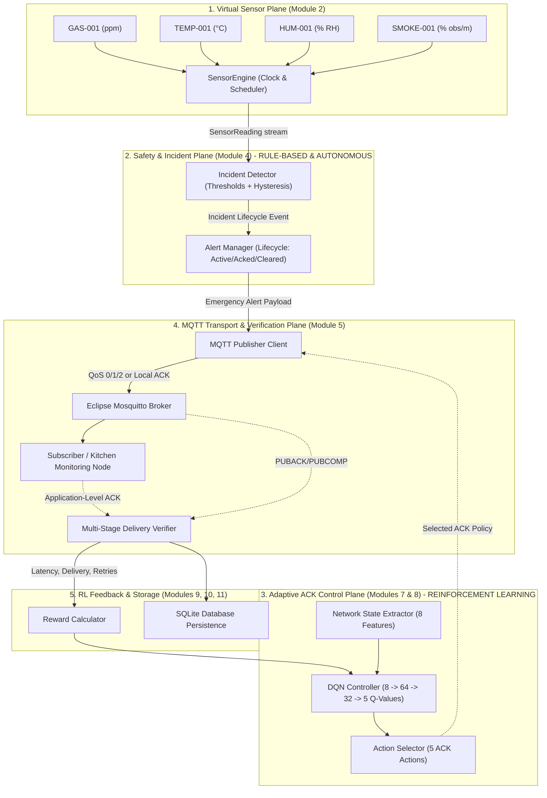
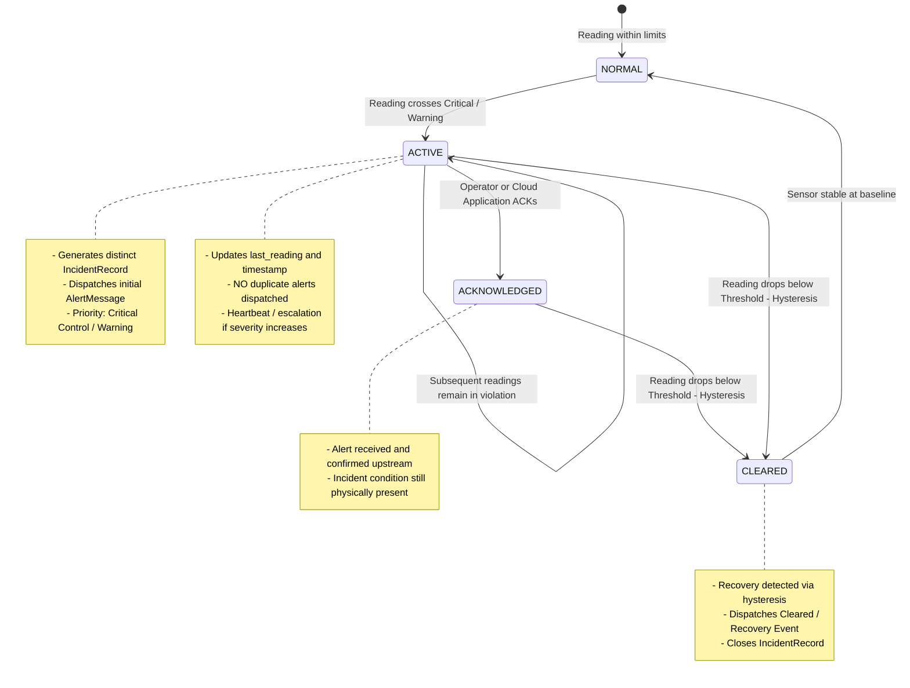

# RL-ACK Emergency-Alert & Adaptive ACK Architecture Specification

## 1. Executive Architecture Overview

The RL-ACK platform establishes a decoupled, end-to-end data pipeline from physical/virtual sensor observation to verified application-level delivery:



---

## 2. Decoupling Guarantee: Safety Detection vs DQN Adaptation

> [!IMPORTANT]
> **Strict Safety Decoupling Rule**:
> 1. **Zero Suppression Risk**: Emergency incident detection and alert generation are strictly deterministic and rule-based. The DQN **never** decides *whether* an emergency alert is created. It is impossible for the DQN to suppress a dangerous gas leak, smoke accumulation, or fire alarm.
> 2. **Orthogonal Responsibilities**:
>    - **Incident Detector & Alert Manager**: Responsible for safety. Decides *what* is dangerous based on physical thresholds and hysteresis rules.
>    - **DQN Controller**: Responsible for communication efficiency. Decides *how* the alert is transported across the network (selecting QoS levels, local ACKs, or selective retransmission) given real-time channel conditions, congestion, and energy constraints.
> 3. **Non-Trivial Baselines**: The DQN's adaptive policy is comparatively benchmarked against five static baseline policies (`QoS 0`, `Local ACK`, `QoS 1`, `Local ACK + Retransmit`, `QoS 2`).

---

## 3. Incident Lifecycle & Alert De-Duplication

To prevent alert flooding (emitting dozens of duplicate alerts every second while an incident condition persists), the `AlertManager` tracks state transitions across an explicit lifecycle:



### Alert Record Specification (`AlertMessage`)

Every alert transmitted across MQTT adheres to the contract implemented in `rl_ack.common.models.AlertMessage`:

| Field Name | Type | Description |
| :--- | :--- | :--- |
| `alert_id` | `str` (UUID) | Unique identifier for this transmission attempt |
| `incident_id` | `str` (UUID) | Persistent identifier tracking the overarching incident |
| `sensor_id` | `str` | Generating sensor (`GAS-001`, `TEMP-001`, etc.) |
| `incident_type` | `str` | Categorical classification (`gas_leak`, `overheating`, etc.) |
| `severity` | `AlertSeverity` | `INFO`, `WARNING`, `CRITICAL` |
| `reading_value` | `float` | Sensor value triggering the alert |
| `threshold_value`| `float` | Configured boundary violated |
| `unit` | `str` | Unit of measurement (`ppm`, `°C`, `% RH`, `% obs/m`) |
| `simulation_time_s`| `float` | Monotonic simulation clock timestamp |
| `created_at_utc` | `str` | ISO 8601 UTC creation wall-clock timestamp |
| `priority` | `TrafficClass`| `CRITICAL_CONTROL`, `HIGH_BANDWIDTH`, `BEST_EFFORT` |
| `destination_topic`| `str` | MQTT publication topic (e.g. `iot/sensors/alerts/GAS-001`) |
| `delivery_status` | `DeliveryStatus`| Current verified lifecycle status |
| `published_at_utc`| `Optional[str]` | Timestamp when published onto socket |
| `broker_ack_at_utc`| `Optional[str]`| Timestamp when broker PUBACK/PUBCOMP received |
| `received_at_utc` | `Optional[str]` | Timestamp when subscriber received payload |
| `app_ack_at_utc` | `Optional[str]` | Timestamp when application-level ACK confirmed |
| `retry_count` | `int` | Number of retransmission attempts |
| `failure_reason` | `Optional[str]` | Diagnostics if transmission failed or timed out |
| `chosen_action` | `Optional[int]` | Action selected by DQN (0..4) or baseline policy |

---

## 4. Multi-Stage Delivery Verification

In accordance with strict MQTT protocol engineering, **an alert is never marked as delivered merely because publication was initiated**.

The lifecycle progresses through six distinct milestones:

```
[1. GENERATED] 
      │ (Alert payload constructed by AlertManager)
      ▼
[2. PUBLISHED] 
      │ (Paho client socket transmit completed)
      ▼
[3. BROKER_ACCEPTED] 
      │ (MQTT PUBACK received for QoS 1, or PUBCOMP for QoS 2)
      ▼
[4. SUBSCRIBER_RECEIVED] 
      │ (Consumer MQTT callback invoked at receiver)
      ▼
[5. PROTOCOL_ACKNOWLEDGED] 
      │ (Transport-layer acknowledgment complete)
      ▼
[6. APPLICATION_DELIVERED]
        (End-to-end receipt validated by application handshake)
```

---

## 5. DQN Adaptive Controller Integration

### State Vector (8 Features)
$$\mathbf{s}_t = \begin{bmatrix}
\text{network\_utilization} \in [0, 1] \\
\text{rolling\_ack\_rate} \in [0, 1] \\
\text{transmit\_queue\_occupancy} \in [0, 1] \\
\text{traffic\_critical\_control} \in \{0, 1\} \\
\text{traffic\_high\_bandwidth\_streaming} \in \{0, 1\} \\
\text{traffic\_best_effort} \in \{0, 1\} \\
\text{remaining\_node\_energy} \in [0, 1] \\
\text{rolling\_latency} \in [0, 1]
\end{bmatrix}$$

### Five DQN Actions (Output Dimension: 5)
1. **Action 0 (`MQTT QoS 0`)**: Best-effort fire-and-forget. Minimal bandwidth and energy; zero delivery guarantee.
2. **Action 1 (`Static Local ACK`)**: Single-hop MAC-layer ACK without broker protocol round-trips.
3. **Action 2 (`MQTT QoS 1`)**: At-least-once delivery with broker `PUBACK` verification and client-side retry.
4. **Action 3 (`Local ACK + Selective Retransmission`)**: Fast local ACK with selective timeout-triggered retry on loss.
5. **Action 4 (`MQTT QoS 2`)**: Exactly-once delivery with 4-step handshake (`PUBLISH` $\to$ `PUBREC` $\to$ `PUBREL` $\to$ `PUBCOMP`). Highest reliability, highest latency and energy consumption.

### Reward Function Formulation
For an alert transmission transition $(s_t, a_t, r_t, s_{t+1})$:

$$R = w_d \cdot \mathbb{I}_{\text{delivered}} - w_l \cdot \frac{\text{Latency}}{\text{Latency}_{\text{max}}} - w_e \cdot E_{\text{consumed}} - w_r \cdot N_{\text{retransmits}} - w_{\text{crit}} \cdot \mathbb{I}_{\text{undelivered\_critical}}$$

- $w_d$: Heavy reward for successful delivery.
- $w_{\text{crit}}$: Severe penalty if a `Critical Control` emergency alert is lost.
- $w_l, w_e, w_r$: Penalties balancing latency, energy consumption, and network retransmission congestion.
